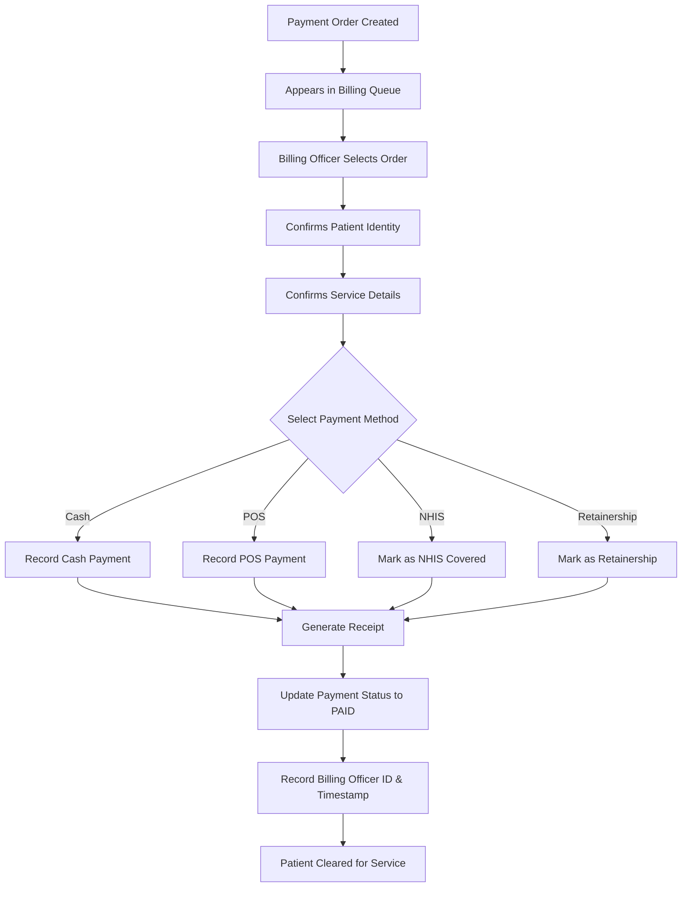

# Central Billing & Payment Verification Module

## Product Requirements Document (PRD)
**Version:** 1.0  
**Last Updated:** December 20, 2025  
**System:** NDC Medical Centre EMR  

---

## Table of Contents

1. [Overview](#1-overview)
2. [Design Principles](#2-design-principles)
3. [Scope](#3-scope)
4. [Payment Order Generation](#4-payment-order-generation)
5. [Central Billing Verification Workflow](#5-central-billing-verification-workflow)
6. [Payment Methods & Handling](#6-payment-methods--handling)
7. [Role-Based Access Control](#7-role-based-access-control)
8. [Service Execution Gating](#8-service-execution-gating)
9. [Consolidated Visit Billing](#9-consolidated-visit-billing)
10. [Audit & Compliance Controls](#10-audit--compliance-controls)
11. [Analytics & Reporting](#11-analytics--reporting)
12. [Security & Data Protection](#12-security--data-protection)
13. [Technical Implementation](#13-technical-implementation)

---

## 1. Overview

### 1.1 Module Description

The **Central Billing & Payment Verification Module** serves as the single authoritative system for managing, verifying, and recording all financial transactions generated across the NDC Medical Centre EMR.

### 1.2 Purpose

This module:
- Records payment before a patient sees a doctor or gets a service (except NHIS/retainership patients)
- Links each payment to the patient and the service received
- Ensures hospital revenue is accurate and transparent
- Helps staff check if a patient has paid before proceeding to lab, radiology, or pharmacy

### 1.3 Key Guarantees

| Guarantee | Description |
|-----------|-------------|
| **Centralized Verification** | All billable services initiated by clinical and administrative modules are centrally verified |
| **Authorization Control** | Only authorized billing officers can confirm payments |
| **Full Traceability** | Every financial transaction is traceable, auditable, and protected from manipulation |

---

## 2. Design Principles

### 2.1 Single Source of Financial Truth
All payments—regardless of originating department—are verified and finalized at a central billing point.

### 2.2 Separation of Duties
- Clinical and operational modules may **request** payment
- Only the Billing Module may **verify** payment

### 2.3 Immutability After Verification
Once a payment is marked as **Paid**, the record becomes read-only and cannot be modified.

### 2.4 Full Auditability
Every payment action is linked to:
- Patient
- Service
- Requesting staff
- Verifying billing officer
- Timestamp

---

## 3. Scope

### 3.1 In Scope

| Feature | Description |
|---------|-------------|
| Payment Order Management | Receipt and management of payment orders from all EMR modules |
| Payment Verification | Verification of payments (Cash, POS, NHIS, Retainership) |
| Receipt Issuance | Automatic receipt generation upon payment verification |
| Invoice Consolidation | Consolidation of multiple charges into visit-level invoices |
| Audit Logging | Complete audit trail and reporting |

### 3.2 Out of Scope

- Collection of clinical data
- Modification of service charges after request
- Clinical decision-making
- Drug inventory or service execution

---

## 4. Payment Order Generation

### 4.1 Definition

A **Payment Order** is a system-generated request for payment created whenever a billable service is initiated by any EMR module.

### 4.2 Originating Modules

Payment Orders may originate from:

| Module | Example Services |
|--------|------------------|
| Patient Registration | Registration fee, consultation booking |
| Clinical Consultation | Consultation fee, procedures |
| Nursing Care | Billable nursing procedures |
| Laboratory | Lab tests, sample collection |
| Radiology & Imaging | X-rays, ultrasounds, CT scans, MRI |
| Pharmacy & Inventory | Medications, supplies |

### 4.3 Payment Order Data Structure

```sql
CREATE TABLE billing_orders (
    billing_id UUID PRIMARY KEY DEFAULT uuid_generate_v4(),
    patient_id UUID NOT NULL REFERENCES patients(patient_id),
    visit_id UUID REFERENCES visits(visit_id),
    
    -- Source tracking
    source_module TEXT NOT NULL, -- 'registration', 'consultation', 'lab', 'radiology', 'pharmacy'
    source_record_id UUID,
    
    -- Service details
    service_code TEXT,
    service_description TEXT NOT NULL,
    quantity INTEGER DEFAULT 1,
    unit_price DECIMAL(12,2) NOT NULL,
    amount_due DECIMAL(12,2) NOT NULL,
    
    -- Payment status
    payment_status TEXT DEFAULT 'Pending', -- 'Pending', 'Paid', 'Waived', 'Cancelled'
    payment_method TEXT, -- 'Cash', 'POS', 'NHIS', 'Retainership'
    
    -- Request tracking
    requested_by_user_id UUID REFERENCES staff(staff_id),
    requested_by_role TEXT,
    
    -- Verification tracking
    verified_by_user_id UUID REFERENCES staff(staff_id),
    verified_at TIMESTAMPTZ,
    receipt_number TEXT,
    
    -- Timestamps
    created_at TIMESTAMPTZ DEFAULT NOW(),
    updated_at TIMESTAMPTZ DEFAULT NOW()
);
```

> **Note:** Payment Orders are created with status `Pending` and cannot be modified by originating modules.

---

## 5. Central Billing Verification Workflow

### 5.1 Billing Queue Dashboard

All pending payment orders appear in the Billing Paypoint dashboard, grouped by patient and visit.

```
┌─────────────────────────────────────────────────────────────────┐
│                    BILLING QUEUE DASHBOARD                       │
├─────────────────────────────────────────────────────────────────┤
│  Patient: John Doe (PID: 12345)                                 │
│  Visit: V-2024-001234 | Started: 10:30 AM                       │
│  ───────────────────────────────────────────────────────────    │
│  □ Consultation Fee          ₦5,000    [Registration]  Pending  │
│  □ Full Blood Count          ₦3,500    [Laboratory]    Pending  │
│  □ Chest X-Ray               ₦8,000    [Radiology]     Pending  │
│  ───────────────────────────────────────────────────────────    │
│  TOTAL DUE: ₦16,500                                             │
│                                                                  │
│  [Select All] [Verify Payment] [Print Quote]                    │
└─────────────────────────────────────────────────────────────────┘
```

### 5.2 Payment Verification Process



### 5.3 Verification Steps

1. Billing Officer selects pending payment order(s)
2. Confirms patient identity and service details
3. Confirms payment method (Cash, POS, NHIS, Retainership)
4. Records payment
5. System updates payment status to **Paid**
6. Receipt number generated automatically
7. Verification timestamp and billing officer ID recorded

---

## 6. Payment Methods & Handling

### 6.1 Cash / POS Payments

| Aspect | Requirement |
|--------|-------------|
| Verification Timing | Payment must be verified **before** service execution |
| Receipt | Issued immediately upon verification |
| Gating | Lab, Radiology, Pharmacy blocked until paid |

### 6.2 NHIS & Retainership

| Aspect | Requirement |
|--------|-------------|
| Payment Orders | Created for tracking purposes |
| Amount | May be set to zero or scheme-covered amount |
| Status | Auto-marked as `Paid (NHIS)` or `Paid (Retainership)` |
| Records | Retained for claims submission and audit |
| Gating | Patients proceed without upfront payment |

### 6.3 Payment Status Flow

```
┌──────────┐     ┌──────────┐     ┌──────────┐
│ PENDING  │ ──► │  PAID    │ ──► │ LOCKED   │
└──────────┘     └──────────┘     └──────────┘
     │                                  │
     │           ┌──────────┐           │
     └─────────► │ WAIVED   │ ◄─────────┘
                 └──────────┘      (requires supervisor)
                      │
                 ┌──────────┐
                 │ CANCELLED│
                 └──────────┘
```

---

## 7. Role-Based Access Control

### 7.1 Permission Matrix

| Role | Create Payment Orders | Verify Payments | Issue Receipts | View Reports | Void Payments |
|------|:--------------------:|:---------------:|:--------------:|:------------:|:-------------:|
| Doctor | ✅ | ❌ | ❌ | ❌ | ❌ |
| Nurse | ✅ | ❌ | ❌ | ❌ | ❌ |
| Lab Technician | ✅ | ❌ | ❌ | ❌ | ❌ |
| Radiology Staff | ✅ | ❌ | ❌ | ❌ | ❌ |
| Pharmacist | ✅ | ❌ | ❌ | ❌ | ❌ |
| Billing Officer | ❌ | ✅ | ✅ | ✅ | ❌ |
| Cashier | ❌ | ✅ | ✅ | ✅ | ❌ |
| Billing Supervisor | ❌ | ✅ | ✅ | ✅ | ✅ |
| Admin | ❌ | ❌ | ❌ | ✅ | ❌ |
| Super Admin | ✅ | ✅ | ✅ | ✅ | ✅ |

### 7.2 Restrictions

> **No role except Billing Officer/Cashier can:**
> - Change payment status
> - Issue receipts
> - Modify verified records

---

## 8. Service Execution Gating

### 8.1 Payment Verification Gate

Services in **Lab**, **Radiology**, and **Pharmacy** cannot proceed unless payment status is **Paid**.

```typescript
// Payment gating check
function canProceedWithService(billingOrder: BillingOrder): boolean {
  // NHIS and Retainership patients bypass payment gate
  if (billingOrder.payment_method === 'NHIS' || 
      billingOrder.payment_method === 'Retainership') {
    return true;
  }
  
  // Cash/POS patients must have paid status
  return billingOrder.payment_status === 'Paid';
}
```

### 8.2 Queue Management Integration

The Queue Management module enforces payment verification:

| Patient Category | Payment Required | Service Gating |
|------------------|:----------------:|:--------------:|
| Cash | ✅ Yes | Blocked until paid |
| POS | ✅ Yes | Blocked until paid |
| NHIS | ❌ No | Proceed immediately |
| Retainership | ❌ No | Proceed immediately |

### 8.3 Gating UI Indicator

```
┌─────────────────────────────────────────────┐
│  LABORATORY QUEUE                           │
├─────────────────────────────────────────────┤
│  ● John Doe      FBC, LFT       ✅ PAID     │
│  ● Jane Smith    Malaria RDT    ⏳ PENDING  │ ← Cannot proceed
│  ● Mike Johnson  Urinalysis     ✅ NHIS     │
└─────────────────────────────────────────────┘
```

---

## 9. Consolidated Visit Billing

### 9.1 Visit-Level Invoice

Multiple payment orders can be consolidated into a single invoice per visit.

```
┌─────────────────────────────────────────────────────────────┐
│  INVOICE #INV-2024-001234                                   │
│  Patient: John Doe | Visit: V-2024-001234                   │
│  Date: December 20, 2024                                    │
├─────────────────────────────────────────────────────────────┤
│  Service                    Qty    Unit Price    Total      │
│  ─────────────────────────────────────────────────────────  │
│  Consultation Fee            1      ₦5,000       ₦5,000     │
│  Full Blood Count            1      ₦3,500       ₦3,500     │
│  Chest X-Ray                 1      ₦8,000       ₦8,000     │
│  Paracetamol 500mg          20      ₦50          ₦1,000     │
│  ─────────────────────────────────────────────────────────  │
│                              SUBTOTAL:           ₦17,500    │
│                              DISCOUNT (5%):      -₦875      │
│                              ─────────────────────────────  │
│                              TOTAL DUE:          ₦16,625    │
│                              AMOUNT PAID:        ₦16,625    │
│                              BALANCE:            ₦0         │
└─────────────────────────────────────────────────────────────┘
```

### 9.2 Partial Payments

- Partial payments may be allowed based on hospital policy
- Visit closed only when all payment orders are resolved
- Outstanding balances tracked per patient

---

## 10. Audit & Compliance Controls

### 10.1 Audit Trail

Each billing record captures:

| Field | Description |
|-------|-------------|
| `source_module` | Originating module (Lab, Radiology, etc.) |
| `requested_by_user_id` | Staff who initiated the request |
| `requested_by_role` | Role of requesting staff |
| `verified_by_user_id` | Billing officer who verified |
| `created_at` | Request timestamp |
| `verified_at` | Verification timestamp |
| `payment_method` | How payment was made |

### 10.2 Data Integrity Rules

| Rule | Enforcement |
|------|-------------|
| **Paid records are immutable** | Database trigger prevents updates |
| **Voids require supervisor approval** | Role-based permission check |
| **No backdated records** | Timestamp auto-generated by system |
| **No deleted payment records** | Soft delete only with audit log |

### 10.3 Audit Log Structure

```sql
CREATE TABLE billing_audit_log (
    audit_id UUID PRIMARY KEY DEFAULT uuid_generate_v4(),
    billing_id UUID REFERENCES billing_orders(billing_id),
    action TEXT NOT NULL, -- 'CREATED', 'VERIFIED', 'VOIDED', 'MODIFIED'
    performed_by UUID REFERENCES staff(staff_id),
    old_values JSONB,
    new_values JSONB,
    ip_address INET,
    user_agent TEXT,
    created_at TIMESTAMPTZ DEFAULT NOW()
);
```

---

## 11. Analytics & Reporting

### 11.1 Available Reports

The Billing Module provides data to the Analytics Module for:

| Report | Description | Frequency |
|--------|-------------|-----------|
| Revenue Summary | Total revenue by day/week/month | Daily |
| Departmental Income | Revenue breakdown by department | Weekly |
| Payment Method Analysis | Cash vs POS vs NHIS breakdown | Monthly |
| NHIS Claims Report | Claims for NHIS submission | Monthly |
| Outstanding Balances | Patients with unpaid bills | Daily |
| Cashier Reconciliation | Daily cash/POS reconciliation | Daily |
| Audit Trail Report | All billing actions for inspection | On-demand |

### 11.2 Dashboard Metrics

```
┌─────────────────────────────────────────────────────────────────┐
│                    BILLING DASHBOARD                             │
├─────────────────────────────────────────────────────────────────┤
│  TODAY'S REVENUE                                                 │
│  ┌──────────┐  ┌──────────┐  ┌──────────┐  ┌──────────┐        │
│  │ ₦245,000 │  │ ₦180,500 │  │ ₦64,500  │  │ ₦125,000 │        │
│  │  Total   │  │   Cash   │  │   POS    │  │   NHIS   │        │
│  └──────────┘  └──────────┘  └──────────┘  └──────────┘        │
│                                                                  │
│  PENDING PAYMENTS: 23 orders (₦156,000)                         │
│  VERIFIED TODAY: 89 orders                                       │
└─────────────────────────────────────────────────────────────────┘
```

### 11.3 Data Privacy

All analytics outputs are anonymized unless identifiers are required for audit purposes.

---

## 12. Security & Data Protection

### 12.1 Security Measures

| Measure | Implementation |
|---------|----------------|
| **Encrypted Storage** | AES-256 encryption for billing records at rest |
| **Encrypted Transmission** | TLS 1.3 for all payment data in transit |
| **Session Timeout** | 15-minute inactivity timeout for billing users |
| **Multi-Factor Authentication** | Required for billing officers |
| **RBAC Enforcement** | Database-level role checks via RLS |
| **Immutability** | Database triggers prevent modification of paid records |

### 12.2 Row-Level Security (RLS)

```sql
-- Only billing roles can update payment status
CREATE POLICY "Billing: Only billing roles can verify payments"
ON billing_orders
FOR UPDATE
TO authenticated
USING (
    get_user_role() IN ('billing_clerk', 'cashier', 'super_admin')
)
WITH CHECK (
    get_user_role() IN ('billing_clerk', 'cashier', 'super_admin')
);

-- Prevent modification of paid records
CREATE POLICY "Billing: Paid records are immutable"
ON billing_orders
FOR UPDATE
TO authenticated
USING (payment_status != 'Paid')
WITH CHECK (true);
```

---

## 13. Technical Implementation

### 13.1 Database Tables

| Table | Purpose |
|-------|---------|
| `billing_orders` | Payment orders from all modules |
| `invoices` | Consolidated visit-level invoices |
| `invoice_items` | Line items within invoices |
| `payments` | Payment records with receipt numbers |
| `price_list` | Service pricing catalog |
| `billing_audit_log` | Audit trail for all billing actions |

### 13.2 API Endpoints

```typescript
// Payment Order APIs
POST   /api/billing/orders              // Create payment order
GET    /api/billing/orders              // List pending orders
GET    /api/billing/orders/:id          // Get order details

// Payment Verification APIs
POST   /api/billing/verify              // Verify payment
POST   /api/billing/verify/batch        // Batch verify multiple orders

// Invoice APIs
GET    /api/billing/invoices            // List invoices
GET    /api/billing/invoices/:id        // Get invoice details
POST   /api/billing/invoices            // Create invoice
POST   /api/billing/invoices/:id/pay    // Record payment

// Reports APIs
GET    /api/billing/reports/revenue     // Revenue report
GET    /api/billing/reports/department  // Department income
GET    /api/billing/reports/audit       // Audit trail
```

### 13.3 Integration Points

```
┌─────────────────┐     ┌─────────────────┐     ┌─────────────────┐
│   Registration  │────►│                 │────►│   Queue Mgmt    │
└─────────────────┘     │                 │     └─────────────────┘
                        │                 │
┌─────────────────┐     │    CENTRAL      │     ┌─────────────────┐
│  Consultation   │────►│    BILLING      │────►│   Analytics     │
└─────────────────┘     │    MODULE       │     └─────────────────┘
                        │                 │
┌─────────────────┐     │                 │     ┌─────────────────┐
│   Laboratory    │────►│                 │────►│   Audit Logs    │
└─────────────────┘     │                 │     └─────────────────┘
                        │                 │
┌─────────────────┐     │                 │
│   Radiology     │────►│                 │
└─────────────────┘     │                 │
                        │                 │
┌─────────────────┐     │                 │
│   Pharmacy      │────►│                 │
└─────────────────┘     └─────────────────┘
```

### 13.4 Event Flow

```typescript
// When a billable service is requested
async function createBillingOrder(params: {
  patientId: string;
  visitId: string;
  sourceModule: 'registration' | 'consultation' | 'lab' | 'radiology' | 'pharmacy';
  sourceRecordId: string;
  serviceCode: string;
  serviceDescription: string;
  amount: number;
}) {
  // 1. Get current user
  const user = await getCurrentUser();
  
  // 2. Create billing order
  const order = await supabase
    .from('billing_orders')
    .insert({
      patient_id: params.patientId,
      visit_id: params.visitId,
      source_module: params.sourceModule,
      source_record_id: params.sourceRecordId,
      service_code: params.serviceCode,
      service_description: params.serviceDescription,
      amount_due: params.amount,
      payment_status: 'Pending',
      requested_by_user_id: user.staffId,
      requested_by_role: user.role,
    })
    .select()
    .single();
  
  // 3. Log audit event
  await logAudit('BILLING_ORDER_CREATED', order);
  
  // 4. Notify billing queue
  await invalidateQueries(['billing', 'queue']);
  
  return order;
}
```

---

## Appendix A: Glossary

| Term | Definition |
|------|------------|
| **Payment Order** | System-generated request for payment when a billable service is initiated |
| **Billing Officer** | Staff authorized to verify payments and issue receipts |
| **Service Gating** | Blocking service execution until payment is verified |
| **Visit-Level Invoice** | Consolidated invoice containing all charges for a single patient visit |
| **NHIS** | National Health Insurance Scheme |
| **Retainership** | Corporate/institutional payment arrangement |
| **RLS** | Row-Level Security - database-level access control |

---

## Appendix B: Status Codes

| Status | Description | Allowed Transitions |
|--------|-------------|---------------------|
| `Pending` | Order created, awaiting payment | → Paid, Waived, Cancelled |
| `Paid` | Payment verified (immutable) | None |
| `Paid (NHIS)` | NHIS covered (immutable) | None |
| `Paid (Retainership)` | Retainership covered (immutable) | None |
| `Waived` | Supervisor approved waiver | None |
| `Cancelled` | Order cancelled before payment | None |

---

## Document History

| Version | Date | Author | Changes |
|---------|------|--------|---------|
| 1.0 | Dec 20, 2025 | System | Initial PRD creation |

---

*This document serves as the authoritative reference for the Central Billing & Payment Verification Module implementation within the NDC Medical Centre EMR System.*
